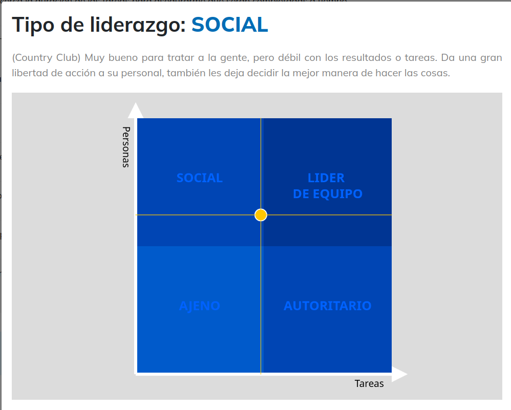

I took two tests to understand my leadership profile:
the [Blake & Mouton test](https://www.uvirtual.org/test-liderazgo-blake-mouton) and
the [Situational Leadership test](https://gc.scalahed.com/recursos/files/r161r/w24518w/Teoria_liderazgo_situacional.pdf).

**Blake & Mouton:** my result was Social (Country Club). This style is very good at dealing with people but weak on
results and tasks. It gives staff a lot of freedom and lets them decide the best way to do things.

**Situational Leadership:**

| Style         | Preference score |
|---------------|------------------|
| Directing     | 2                |
| Persuading    | 2                |
| Participating | 5                |
| Delegating    | 3                |

My predominant style is Participating: I tend to involve people, listen to their opinions and build decisions
together. My secondary style combines directing and delegating depending on the situation.

**Reflection:** both tests point in the same direction. I care about the people on the team and I prefer building
consensus over imposing decisions. The weak side is the one Blake & Mouton names: concern for results and deadlines. In
team projects I should practice setting clear goals and checking progress, without losing the collaborative approach.
